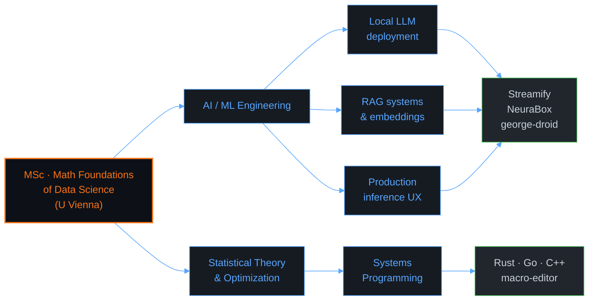

<div align="center">

<a href="https://firexrwt.github.io">
  
</a>

<br/>

<a href="https://firexrwt.github.io"></a>
<a href="https://www.linkedin.com/in/stepaneremeev/"></a>
<a href="mailto:business@firexrwt.com"></a>

<br/>


</div>

---

## About

> Technology builder based in Vienna. Transforming research-grade ideas into shipping software — AI streaming companions, RAG systems, music tooling, mobile productivity, terminal UX.

```text
  ┌─ Origin ──── Python @ Yandex Lyceum, Android @ Samsung IT School
  ├─ Now ─────── MSc Mathematical Foundations of Data Science, U Vienna
  ├─ Focus ───── Local LLMs · RAG · model deployment · production UX
  └─ Stack ───── Python · Kotlin · TypeScript · Rust · Go · C++
```

A driving formula for the current chapter — empirical risk minimization, the backbone of every model I train:

$$\hat{\theta} = \arg\min_{\theta \in \Theta}\; \frac{1}{n}\sum_{i=1}^{n} \mathcal{L}\bigl(f_\theta(x_i),\, y_i\bigr) \;+\; \lambda\,\Omega(\theta)$$

---

## Tech Stack

<table>
  <tr>
    <td valign="top" width="50%">

**Languages**

<p>


</p>

**AI / ML**

<p>


</p>

  </td>
  <td valign="top" width="50%">

**Web / Mobile**

<p>


</p>

**Tools / DevOps**

<p>


</p>

**Editor / Daily**

<p>


</p>

  </td>
  </tr>
</table>

---

## GitHub Statistics

<div align="center">

<picture>
  <source media="(prefers-color-scheme: dark)" srcset="https://github-readme-stats.vercel.app/api?username=firexrwt&show_icons=true&hide_border=true&include_all_commits=true&count_private=true&theme=tokyonight&bg_color=0D1117&title_color=58A6FF&icon_color=58A6FF&text_color=C9D1D9&ring_color=58A6FF"/>
  <source media="(prefers-color-scheme: light)" srcset="https://github-readme-stats.vercel.app/api?username=firexrwt&show_icons=true&hide_border=true&include_all_commits=true&count_private=true&theme=default&title_color=0969DA&icon_color=0969DA&text_color=24292F&ring_color=0969DA"/>
  
</picture>
<picture>
  <source media="(prefers-color-scheme: dark)" srcset="https://github-readme-streak-stats.herokuapp.com?user=firexrwt&hide_border=true&background=0D1117&stroke=58A6FF&ring=58A6FF&fire=F97316&currStreakLabel=58A6FF&sideLabels=C9D1D9&dates=8B949E&currStreakNum=C9D1D9&sideNums=C9D1D9"/>
  <source media="(prefers-color-scheme: light)" srcset="https://github-readme-streak-stats.herokuapp.com?user=firexrwt&hide_border=true&stroke=0969DA&ring=0969DA&fire=F97316&currStreakLabel=0969DA"/>
  
</picture>

<br/>

<picture>
  <source media="(prefers-color-scheme: dark)" srcset="https://github-readme-stats.vercel.app/api/top-langs/?username=firexrwt&layout=compact&hide_border=true&langs_count=10&theme=tokyonight&bg_color=0D1117&title_color=58A6FF&text_color=C9D1D9"/>
  <source media="(prefers-color-scheme: light)" srcset="https://github-readme-stats.vercel.app/api/top-langs/?username=firexrwt&layout=compact&hide_border=true&langs_count=10&theme=default&title_color=0969DA&text_color=24292F"/>
  
</picture>

<br/><br/>

<picture>
  <source media="(prefers-color-scheme: dark)" srcset="https://github-readme-activity-graph.vercel.app/graph?username=firexrwt&theme=github-compact&hide_border=true&bg_color=0D1117&color=58A6FF&line=58A6FF&point=F97316&area=true&area_color=58A6FF"/>
  <source media="(prefers-color-scheme: light)" srcset="https://github-readme-activity-graph.vercel.app/graph?username=firexrwt&theme=minimal&hide_border=true&color=0969DA&line=0969DA&point=F97316&area=true"/>
  
</picture>

<br/>

<picture>
  <source media="(prefers-color-scheme: dark)" srcset="https://github-profile-trophy.vercel.app/?username=firexrwt&theme=tokyonight&no-frame=true&no-bg=true&row=1&column=7&margin-w=10"/>
  <source media="(prefers-color-scheme: light)" srcset="https://github-profile-trophy.vercel.app/?username=firexrwt&theme=flat&no-frame=true&no-bg=true&row=1&column=7&margin-w=10"/>
  
</picture>

</div>

---

## Featured Projects

<div align="center">

<a href="https://github.com/firexrwt/george-droid">
  <picture>
    <source media="(prefers-color-scheme: dark)" srcset="https://github-readme-stats.vercel.app/api/pin/?username=firexrwt&repo=george-droid&hide_border=true&theme=tokyonight&bg_color=0D1117&title_color=58A6FF&icon_color=58A6FF&text_color=C9D1D9"/>
    
  </picture>
</a>
<a href="https://github.com/firexrwt/Streamify">
  <picture>
    <source media="(prefers-color-scheme: dark)" srcset="https://github-readme-stats.vercel.app/api/pin/?username=firexrwt&repo=Streamify&hide_border=true&theme=tokyonight&bg_color=0D1117&title_color=58A6FF&icon_color=58A6FF&text_color=C9D1D9"/>
    
  </picture>
</a>
<a href="https://github.com/firexrwt/NeuraBox">
  <picture>
    <source media="(prefers-color-scheme: dark)" srcset="https://github-readme-stats.vercel.app/api/pin/?username=firexrwt&repo=NeuraBox&hide_border=true&theme=tokyonight&bg_color=0D1117&title_color=58A6FF&icon_color=58A6FF&text_color=C9D1D9"/>
    
  </picture>
</a>
<a href="https://github.com/firexrwt/macro-code-editor">
  <picture>
    <source media="(prefers-color-scheme: dark)" srcset="https://github-readme-stats.vercel.app/api/pin/?username=firexrwt&repo=macro-code-editor&hide_border=true&theme=tokyonight&bg_color=0D1117&title_color=58A6FF&icon_color=58A6FF&text_color=C9D1D9"/>
    
  </picture>
</a>
<a href="https://github.com/firexrwt/gitplex">
  <picture>
    <source media="(prefers-color-scheme: dark)" srcset="https://github-readme-stats.vercel.app/api/pin/?username=firexrwt&repo=gitplex&hide_border=true&theme=tokyonight&bg_color=0D1117&title_color=58A6FF&icon_color=58A6FF&text_color=C9D1D9"/>
    
  </picture>
</a>
<a href="https://github.com/firexrwt/TERMINAL-RENDERER">
  <picture>
    <source media="(prefers-color-scheme: dark)" srcset="https://github-readme-stats.vercel.app/api/pin/?username=firexrwt&repo=TERMINAL-RENDERER&hide_border=true&theme=tokyonight&bg_color=0D1117&title_color=58A6FF&icon_color=58A6FF&text_color=C9D1D9"/>
    
  </picture>
</a>

</div>

<details>
<summary><b>Full project index</b> — click to expand</summary>

<br/>

| Project | Stack | Status | Description |
|---|---|---|---|
| **[george-droid](https://github.com/firexrwt/george-droid)** | Python · Together AI · Piper · RAG |  | AI streaming companion (Neuro-Sama-inspired). Cloud LLM + STT, local RAG memory, Twitch chat. |
| **[Streamify](https://github.com/firexrwt/Streamify)** | React 19 · TypeScript · Spotify API |  | Interactive music widget for streamers. Adaptive design, dynamic BG, progress, QR, Channel Points (planned). |
| **[NeuraBox](https://github.com/firexrwt/NeuraBox)** | React · Tailwind · Python |  | Desktop assistant for local neural networks. Multi-model support. |
| **[FIREX BOT](https://github.com/firexrwt/FIREX-BOT)** | Python · Nextcord |  | Open-source Discord bot — moderation, levels, Twitch notifications, mini-games. |
| **[My Time](https://github.com/firexrwt/MyTime)** | Kotlin · Material Design |  | Android time management for freelancers. Java → Kotlin rewrite. Samsung IT School graduation project. |
| **[gitplex](https://github.com/firexrwt/gitplex)** | Python · Textual · TUI |  | Terminal Git client. Keyboard-driven, rich TUI, no leaving terminal. |
| **[macro-editor](https://github.com/firexrwt/macro-code-editor)** | Rust · syntect · LSP |  | Fast terminal code editor. File tree, syntax highlight, LSP autocomplete, tabs, mouse, TOML config. |
| **[TERMINAL-RENDERER](https://github.com/firexrwt/TERMINAL-RENDERER)** | Python · Faster-Whisper · ffmpeg |  | Pixel-by-pixel video renderer with terminal aesthetic. Word-level audio sync via Whisper. Linux only. |
| **[Portfolio](https://github.com/firexrwt/firexrwt.github.io)** | HTML · CSS · JS |  | Multilingual (RU/EN/DE), modern cyber design, GitHub Pages. → [firexrwt.github.io](https://firexrwt.github.io) |

</details>

---

## Current Focus



---

## Contact

<div align="center">

<a href="https://www.linkedin.com/in/stepaneremeev/"></a>
<a href="mailto:business@firexrwt.com"></a>
<a href="https://firexrwt.github.io"></a>
<a href="https://github.com/firexrwt"></a>

</div>

---

<div align="center">

<sub><i>Transforming ideas into reality through code, one project at a time.</i></sub>

<br/>

<sub><code>git commit -m "keep building"</code></sub>

</div>
